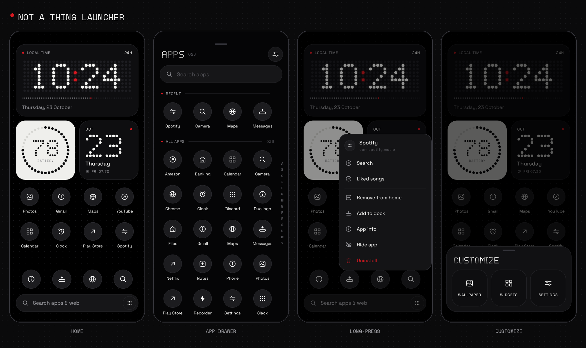
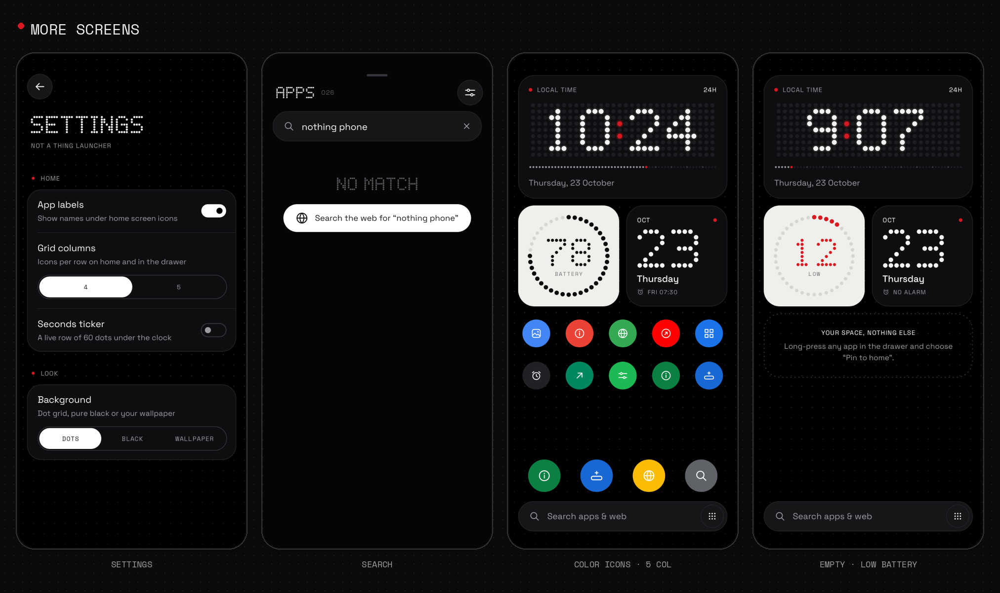

# Not-a-Thing Launcher

[](https://github.com/alakmar344/Not-a-thing-launcher/actions/workflows/build.yml)
[](https://github.com/alakmar344/Not-a-thing-launcher/releases/latest)

A Nothing OS–inspired Android home screen: monochrome, dot-matrix, quiet — with red used only where something needs your attention.

**Version 9.0** is a full-functionality pass: every claim below is backed by native Android APIs — real drag-and-drop across pages, dock and drop-zone targets, real widget hosting through `AppWidgetHost`, live media-session playback controls, a first-run onboarding flow that offers the system HOME-role handoff, and versioned layout persistence that upgrades installs **without losing user data, settings, or layouts**.





> All images above are real renders of the app's layouts and views, produced by the screenshot test suite in `app/src/test` (Cash App Paparazzi / Android Layoutlib) — not mock-ups.

---

## 📚 Documentation Index

Comprehensive documentation has been prepared across dedicated architecture, feature, and visual guides:

- **[Release v8.0 Notes](docs/RELEASE_V8.md)** — Detailed overview of Release v8, bug fixes, changelog, and APK binaries.
- **[Feature Catalog](docs/FEATURES.md)** — Deep-dive into multi-page workspaces, bespoke Nothing elements, Max Icons (2×2), dynamic folders, gesture navigation, and theming.
- **[System Architecture](docs/ARCHITECTURE.md)** — Core components (`MainActivity`, `WorkspacePageAdapter`, `AppDrawerFragment`), data model, DotFont rendering engine, and state management.
- **[Visual Showcase & Screenshots](docs/SCREENSHOTS.md)** — High-resolution Paparazzi screenshot renders for every launcher screen, element, and dialog.

---

## ⬇️ Download Latest APK (Build v9)

- **[Download Latest APK (Release v9)](https://github.com/alakmar344/Not-a-thing-launcher/releases/latest)**

Each release contains:
- `NothingLauncher-release.apk` (ProGuard-optimized production build)
- `NothingLauncher-debug.apk` (Debug build with verbose instrumentation)
- `NothingLauncher-screenshots.zip` (Automated Paparazzi layoutlib test captures)

Install it like any APK. On first launch the **onboarding tour** explains the core gestures, offers a theme choice, and triggers the native *set as default launcher* (HOME role) prompt. Upgrading an existing install keeps everything: pages, folders, widgets, dock, recents, and every setting (`LauncherPrefs` uses versioned schema migrations and never wipes data on compile-time upgrades).

### Local signed artifact

The repository build produces a production-signed APK at:

```text
dist/Not-a-Thing-Launcher-9.0-release.apk
```

`dist/` is the canonical hand-off location. The release APK is signed with the project key, not the Android debug key, so it can be installed over earlier 9.x builds made from this workspace.

---

## 🔐 Release signing & update compatibility

Release builds read signing material from two **ignored** files:

- `keystore/release.jks` — the RSA key pair.
- `keystore.properties` — store/key passwords and the `nothinglauncher` alias.

Keep both files for every future release of `com.nothinglauncher`. Losing them means Android will reject updates signed with a different key. The build fails rather than silently falling back to the debug key when the release signing configuration is missing.

Build locally (Windows):

```powershell
.\gradlew.bat :app:assembleDebug --console=plain
.\gradlew.bat :app:assembleRelease --console=plain
```

The release build enables R8 shrinking. Verify the signer before distributing:

```powershell
& "$env:ANDROID_HOME\build-tools\34.0.0\apksigner.bat" verify --print-certs `
  app\build\outputs\apk\release\app-release.apk
```

---

## 🆕 What v9.0 Fixed & Added

| Area | Change |
|---|---|
| **Onboarding** | First launch now really opens the welcome tour (it previously existed but was never wired), including the set-as-default prompt. Re-runnable from *Settings → Show welcome tour*. |
| **Double-Tap to Sleep** | Uses the accessibility global action (`GLOBAL_ACTION_LOCK_SCREEN`); the old code broadcast a no-op intent. If the optional service is off, the launcher explains instead of failing silently. |
| **Media Controller element** | Now a real player: live track/artist, real play/pause/next/previous via `MediaSessionManager` transport controls, disabled-but-honest state before notification access is granted, tap-to-open current player app. |
| **Folder rename** | New *Rename* chip inside the folder sheet (previously `renameFolder` existed with no UI). |
| **Element & widget reordering** | Long-press popups for bespoke elements and hosted widgets gained *Move Up / Move Down* alongside *Remove*, making pages fully editable. |
| **Settings → Permissions & capabilities** | Rows for Usage access, Notification access and Accessibility gestures with live on/off subtitles. |
| **Motion & microphone permissions** | Dedicated rows request `ACTIVITY_RECOGNITION` and `RECORD_AUDIO` in context, report sensor/permission state honestly, and refresh the live pedometer or recorder immediately. |
| **Weather & step personalisation** | Weather location can be a fixed city or automatic network lookup; the daily step goal is editable from Settings. Both persist across upgrades. |
| **Folder app actions** | Long-press an app inside a folder for Open, Move to home, Enlarge, Dock and App info. Dragging out of a folder is supported and never leaves a duplicate. |
| **Widget management** | Hosted widgets can be configured, made taller/shorter, reset to provider height, reordered within a page, moved between pages, or removed. |
| **Drag/drop integrity** | Home apps, dock apps, enlarged apps and folder contents share a single-copy invariant; dock copies are intentional. Drops route through native workspace, dock, folder-merge and top action zones. |
| **Data safety on upgrade** | `versionCode 11` replaces 8.x in place; `SCHEMA_VERSION` migrations keep `onboarding_complete` behavior for existing users. Release builds are signed with a stable project key so future versions install over this one. |

---

## ⚡ Highlights & Key Features

### Multi-Page Workspace & Dynamic Home
- **Horizontally Paginated Workspace** — Swipe left and right smoothly between customizable home screen pages.
- **Minimalist Dot Page Indicator** — Animated dot tracker that dynamically stretches and morphs with scroll position.
- **Page Management** — Add blank pages or remove pages on the fly directly from the *Home Customisation* sheet.
- **Max Icons (Enlarge 2×2)** — Expand any pinned app icon into a 2×2 hero tile matching Nothing OS 2.5/3.0.
- **Workspace App Folders** — Group apps into clean Nothing dot folders with mini-icon previews and folder manager dialog.

### Bespoke Nothing Elements Suite
- **LED-Panel Clock** — Dot-matrix display with pulsating accent colon, 12/24H format, and live 60-dot seconds ticker.
- **Compact Battery Ring** — 40-dot ring that turns red at ≤15% and breathes while charging.
- **Battery Gauge Hero Tile (v8.0)** — Full-width live battery % readout in DotFont with a 28-dot circular capacity meter and charging bolt.
- **Quick Note / Daily Quote (v8.0)** — Customizable dot-matrix scratchpad on your home screen; single tap to edit your daily quote or notes.
- **Wallpaper & Style Center (v8.0)** — Instant switching between Nothing Dot Matrix, Solid Minimalist (OLED black/white), and System Wallpaper.
- **Procedural Weather Tile** — Live dot-matrix temperature, procedural sun & cloud graphics, and condition forecasts.
- **Quick Toggles Tile** — 4 system controls (Wi-Fi, Bluetooth, Flashlight hardware torch, and Sound mode cycler).
- **Step Counter (Pedometer)** — 36-dot progress ring tracking daily steps with live count in dot-matrix typography.
- **Heading Compass** — Procedural dot-matrix compass rose with accent North indicator and degrees heading.
- **Screen Time & Wellbeing** — Daily active time in dot-matrix typography with a 7-segment dot usage bar.
- **Storage & RAM Meter** — Device capacity meter with DotFont free GB readout and circular dot fullness ring.
- **World Clock Tile** — Dual time-zone dot clock showing local and UTC/London times.
- **Third-Party AppWidgets** — Host any standard Android widget on any workspace page.

### Theming, Icons & Gestures
- **Pure OLED Dark & Minimalist Light Modes** — Pure `#000000` dark mode or bone-white `#F6F6F4` light mode.
- **Nothing Monochrome Icon Engine** — Uses Android 13+ monochrome themed icons when available, or procedural monochrome discs.
- **Double-Tap to Sleep** — Double-tap any empty home area to turn off the display.
- **Follows-Your-Finger Drawer** — Fluid drag physics with real-time background blur.
- **Multi-Tier Ranked Search** — Prefix, word boundary, substring, and acronym matches ("yt" → YouTube) with web search fallback.
- **A–Z Alphabet Dot Scroller** — Fast alphabetical scrub bar with dot-matrix letter bubble and haptic ticks.

---

## 🏛️ Architecture & Source Structure

| Path | Description |
|---|---|
| `app/src/main/java/.../MainActivity.kt` | Hosts home + drawer, finger-tracking drawer controller, popups, and wallpaper/style sheet |
| `app/src/main/java/.../HomeFragment.kt` | Multi-page horizontal workspace (`workspaceRecycler` + `PagerSnapHelper`), page indicator, dock |
| `app/src/main/java/.../WorkspacePageAdapter.kt` | Dynamically renders bespoke elements, 3rd-party widgets, and drag-and-drop app grids |
| `app/src/main/java/.../BatteryGaugeDotsView.kt` | Full-width live battery % readout with circular 28-dot capacity meter |
| `app/src/main/java/.../QuoteDotsView.kt` | User scratchpad / daily quote element rendered in DotFont |
| `app/src/main/java/.../Sheets.kt` | Bottom sheets: Home Customisation, Wallpaper & Style, Edit Note, Confirmations |
| `app/src/main/java/.../DotFont.kt` | Procedural 5×7 dot-matrix rasterizer for alphanumeric characters and system glyphs |
| `app/src/main/java/.../DotGridDrawable.kt` | Signature Nothing dot grid background canvas |
| `app/src/test/java/.../ScreensTest.kt` | Paparazzi layoutlib visual regression and screenshot testing suite |

---

## 🧪 Testing with Paparazzi

Render pixel-perfect screenshot captures without an emulator:

```bash
# Record all snapshots into app/src/test/snapshots/images
./gradlew recordPaparazziDebug

# Verify layouts against recorded snapshots
./gradlew testDebugUnitTest
```
