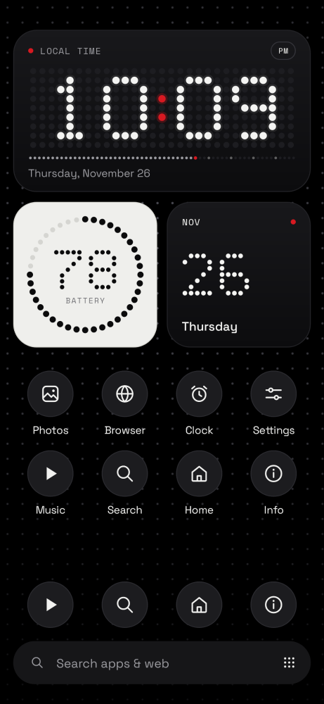
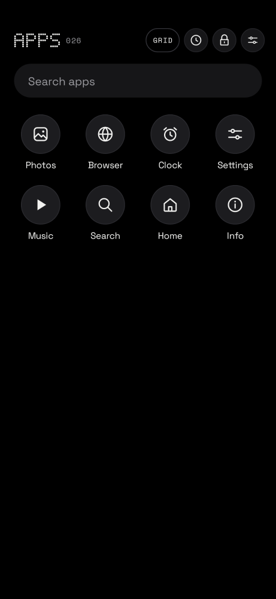
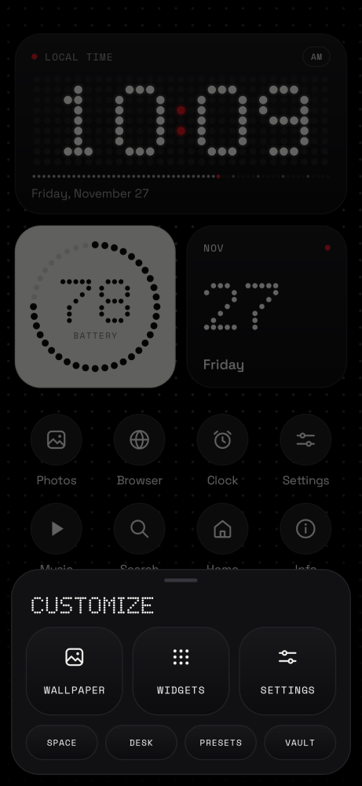
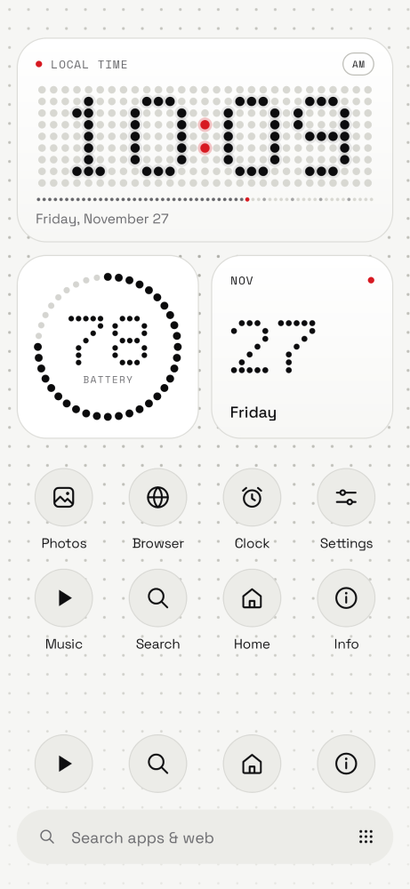

# Not-a-Thing Launcher

[](https://github.com/alakmar344/Not-a-thing-launcher/actions/workflows/build.yml)
[](https://github.com/alakmar344/Not-a-thing-launcher/releases/latest)

An independent, minimalist dot-matrix Android home screen built for phones first and adaptive on big screens (tablets, foldables, and docked displays): monochrome, dot-matrix, tactile — with hardware phosphor accents used where something needs your attention.

Under the hood it is **stock AOSP Launcher3** (`android-14.0.0_r75`) with the Not a Thing experience layered on top, so workspaces, folders, drag & drop, widget resizing, and app shortcuts follow stock Android cleanly.

**Version 15** · runs on Android 8.0 – 17 · targets Android 16 (API 36)

<p>
  
  
  
  
</p>

## What you get in v15

- **Live Cross-Surface Telemetry & Inline Hardware Accent Studio:** 1-tap inline 5-dot Hardware Accent Swatch strips right inside `CustomizeSheet` and Settings (**Studio 15**) with real-time home & widget synchronization (`Focus`, `Caffeine`, `AccentPalette`, `WidgetSurface`, `DrawerLayoutMode`, and labels sync instantaneously across Home, Drawer, `-1` Dock Space, and all 13 widgets without stale icon caches or wasted background timers).
- **World Clock, Smart Work-Tab Drawer & Fail-Closed Vault Polish:** `DotMatrixClockView` renders true timezone clocks and dates in World Clock mode across Home, Desk HUD, and StandBy Dream; `NothingAllAppsContainerView` cleanly separates Personal, Work, and Search adapters (fixing hidden filtering, Minimal List, and Categories on Work profiles); `HiddenVaultSheet` adds explicit 1-tap **UNHIDE** pills + custom labels; and `LauncherEntryActivity` adapts light/dark system chrome cleanly with Import/Export JSON symmetry.
- **Refined Dot-Matrix Craft (`15` Visual & Stability Upgrades):** Crisp hairline search pills, schematic drawer category headers with pill count badges, Focus Note cards with edit affordances in Desk HUD, cardinal calibration ticks on `GlyphMatrixCanvasView`, zero-drain `LifecycleFrameLayout` gating for `FocusTimerWidget`, >99m focus timer support, and modern `AudioTrack.Builder` synthesis in `FocusSoundEngine`.
- **Android StandBy Screensaver (`NothingDreamService`), 4-Stage Desk HUD, 13 Widgets & On-Device Digest:** Charging/docked OLED StandBy clock console, **Gravity / Life / Snake** Kinetic Matrix widget, App Stack Max Icon mode, `Open-Meteo` rain/wind sparklines, procedural ambient soundscapes, and offline Command Search (`/`).

Full guide: [`docs/FEATURES.md`](docs/FEATURES.md).

## Install and update

Download **`app-release.apk`** from the newest [release](https://github.com/alakmar344/Not-a-thing-launcher/releases)
and set it as your home app (or launch **Not a Thing** from the drawer to open the guided Setup & Permissions Hub).
Every push to `main` or matching `v*` tag builds signed APKs that install over the previous build.
See [`docs/RELEASING.md`](docs/RELEASING.md) for signing and upgrade details.

> Upgrading from v14 or earlier? Uninstall once before installing v15: builds since v14.1 use the secret-managed release signing key.

## Build

Requires JDK 17 and Android SDK (`compileSdk 35`, `minSdk 26`, `targetSdk 36`).

```bash
./gradlew assembleDebug        # app/build/outputs/apk/debug/app-debug.apk
./gradlew assembleRelease      # R8-minified APK + verifyReleaseReflection check
./gradlew testDebugUnitTest    # unit, Robolectric, and Paparazzi golden tests
./gradlew recordPaparazziDebug # re-record screenshot goldens after a visual change
```

On Windows use `gradlew.bat`. Paparazzi screenshots run on JVM layoutlib without an emulator
(note: Windows Application Control environments that block `libicuuc_stubdata.dll` can still
run non-Paparazzi unit/Robolectric tests such as `VisualTierTest`, `LauncherRuntimeTest`,
`V13FeaturesTest`, `V14FeaturesTest`, `V14_1AuditFixesTest`, and `V15FeaturesTest`).

## Docs

| | |
|---|---|
| [`docs/ARCHITECTURE.md`](docs/ARCHITECTURE.md) | Source layout, AOSP extension points, v15 subsystems, and R8 reflection contract |
| [`docs/FEATURES.md`](docs/FEATURES.md) | Complete guide to StandBy Screensaver, Kinetic Matrix, Digest, Soundscapes, Matrix Desk HUD, 13 widgets, Big-Screen Studio & Settings |
| [`docs/SCREENSHOTS.md`](docs/SCREENSHOTS.md) | Visual golden tests (phone & tablet) and host notes |
| [`docs/RELEASING.md`](docs/RELEASING.md) | How builds are published and installed as updates; GitHub secret signing |
| [`CHANGELOG.md`](CHANGELOG.md) | Release history through v15 |
| [`NOTICE`](NOTICE) | Third-party copyrights, AOSP Apache 2.0 & font attributions, and trademark disclaimer |
| [`AGENTS.md`](AGENTS.md) | Rules for AI coding agents working in this repo |
| [`docs/archive/`](docs/archive/) | Archived documentation for v13, v12, and pre-v11.0 releases |

## Project layout

| Path | What it is |
|---|---|
| `app/` | The Not a Thing app (`com.nothinglauncher`): theme, `-1` Dock Space overlay, StandBy Dream, Matrix Desk HUD, 13 widgets, search, drawer, vault, settings |
| `launcher3/`, `iconloader/`, `animationlib/` | Gradle modules compiling upstream AOSP sources (`launcher3/src` holds stand-ins and `src_ui_overrides`) |
| `third_party/aosp/` | Unmodified AOSP Launcher3 + SystemUI libraries (`android-14.0.0_r75`) |
| `tools/` | Generators for Launcher3's flags and theme; R8 release-reflection verification |
| `keystore/` | Local release signing directory (git-ignored; CI loads signing key from GitHub Actions secrets) |

Fonts: Space Grotesk and Space Mono, SIL Open Font License (`licenses/`). See [`NOTICE`](NOTICE).
