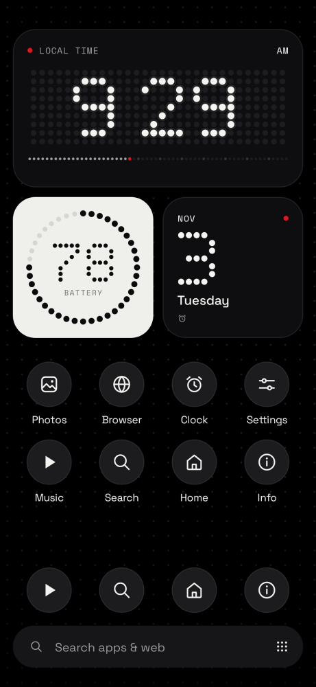
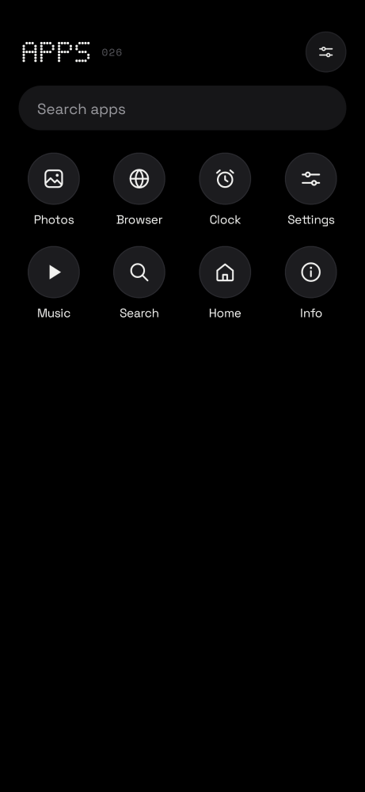
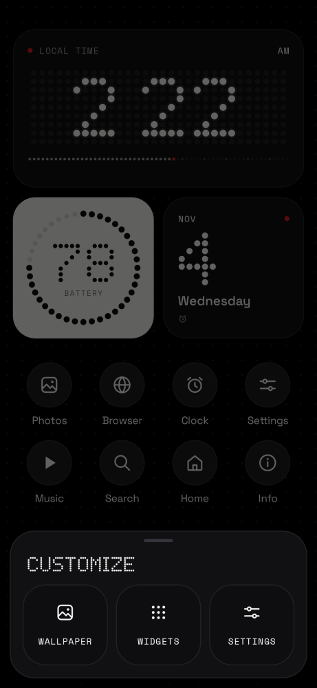
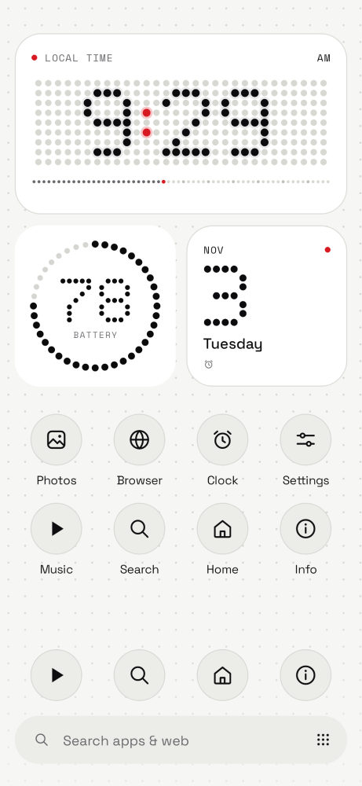

# Not-a-Thing Launcher

[](https://github.com/alakmar344/Not-a-thing-launcher/actions/workflows/build.yml)
[](https://github.com/alakmar344/Not-a-thing-launcher/releases/latest)

A Nothing OS–inspired Android home screen: monochrome, dot-matrix, quiet — with red used only where something needs your attention.

**Version 11.1** is built on **stock Android**: the home screen is AOSP **Launcher3** (the open-source launcher behind Pixel's), and Not a Thing is a design layer on top of it. Home screen, app drawer, folders, widgets, drag & drop, app shortcuts and settings all behave exactly like stock Android. Targets Android 15 (API 35, matching `compileSdk`), with a release build tuned for R8 to actually shrink/optimize the app (see `CHANGELOG.md`).

Everything you see is the Not a Thing v10 design; Launcher3 does the work behind it:

- **Not a Thing palette** – Launcher3's wallpaper-derived Material You colours are replaced by a fixed monochrome palette with Nothing red (all apps, folders, popups, widget picker, settings).
- **Space Grotesk** typography and red notification dots.
- **Home** – black (or bone) dot-grid backdrop, the LED clock and battery & date tiles on first run, and the "Search apps & web" pill under the dock.
- **Icons** – every app as a glyph in a disc (or colour artwork in a circle), on home, dock, folders and in the drawer.
- **Drawer** – dot-matrix "APPS" header with app count and settings, v10 search pill.
- **Customize sheet** on long-press (wallpaper & style, widgets, settings) and the v10 settings screen.
- **Dot-matrix elements** in the stock widget picker (long-press home → Widgets → *Not a Thing*): LED clock, battery & date, weather, media player.
- **Monochrome or colour icons**, backdrop, grid and more in the v10 settings (long-press home → Settings).

<p>
  
  
  
  
</p>

> Screenshot rendered by the Paparazzi tests in `app/src/test` (CI publishes fresh ones with every release). More in [`docs/SCREENSHOTS.md`](docs/SCREENSHOTS.md).

### Docs

| Doc | What's in it |
|---|---|
| [`docs/ARCHITECTURE.md`](docs/ARCHITECTURE.md) | How the Not a Thing layer hooks into Launcher3 |
| [`docs/FEATURES.md`](docs/FEATURES.md) | Full feature list |
| [`docs/SCREENSHOTS.md`](docs/SCREENSHOTS.md) | Current screenshots |
| [`CHANGELOG.md`](CHANGELOG.md) | Release history |
| [`AGENTS.md`](AGENTS.md) | Rules for AI coding agents working in this repo |
| [`docs/archive/`](docs/archive/) | Historical docs for the pre-v11.0 from-scratch launcher — superseded, kept for reference only |

### Project layout

| Path | What it is |
|---|---|
| `third_party/aosp/` | Unmodified AOSP Launcher3 + SystemUI libraries (`android-14.0.0_r75`), see its README |
| `launcher3/`, `iconloader/`, `animationlib/` | Gradle modules that build the AOSP sources; `launcher3/src` holds the platform stand-ins and the override layer |
| `app/` | The Not a Thing app (`com.nothinglauncher`): theme, glance, elements |
| `tools/` | Generators for Launcher3's flags and the Not a Thing palette |

### Building

GitHub Actions builds the debug and release APKs on every push (`.github/workflows/build.yml`) and attaches them to the release. Locally: `./gradlew assembleDebug` (JDK 17, Android SDK 35).

> **Upgrading from 10.x:** the APK installs over the old version (same package and signing key), but the home screen layout starts fresh, because stock Launcher3 keeps its own layout database. The 10.x launcher's docs moved to [`docs/archive/`](docs/archive/) — it was a different, from-scratch codebase.

---

## 🔐 Release signing & update compatibility

Android only installs an update if it is signed with the **same key** as the installed app. Every old GitHub release (v2 → v10.0) was signed with a different throwaway key that GitHub Actions generated and then discarded. That is why updates failed.

**Fixed:** all builds are now signed with one permanent key, `keystore/stable-signing.p12`, and every build gets a higher `versionCode` (`2000 + GitHub run number`). Nothing needs configuring. From the next release on, just install the new APK over the old one.

**One last uninstall is unavoidable** for people who already have an old version. Moving an installed app to a new key ([APK Signature Scheme v3 key rotation](https://source.android.com/docs/security/features/apksigning/v3)) needs the *old* private key, and those keys no longer exist.

Optional: your own key can be supplied as the secrets `RELEASE_KEYSTORE_BASE64`, `RELEASE_KEYSTORE_PASSWORD`, `RELEASE_KEY_ALIAS` and `RELEASE_KEY_PASSWORD`. Add them now or never, because changing keys later forces another uninstall.

### Optional: `.aab` files, correct release names and re-signed old releases

The automation that pushes this repo is not allowed to edit `.github/workflows/`. The live workflow publishes every `main` build as **"Release v10.0"** (a hard-coded tag). If you want releases named after the real version (currently v11.1), the `.aab` (Android App Bundle) attached to releases, and a one-click button that re-signs all old releases (v2 → v9.0) with the same key, paste the contents of `ci/workflows/build.yml` over `.github/workflows/build.yml` in the GitHub web editor. To re-sign the old releases, open **Actions → Build and Release APK → Run workflow** and tick *rebuild old releases*.

Build locally (Windows):

```powershell
.\gradlew.bat :app:assembleDebug --console=plain
.\gradlew.bat :app:assembleRelease --console=plain
```

The release build enables R8 shrinking. Verify the signer before distributing:

```powershell
& "$env:ANDROID_HOME\build-tools\34.0.0\apksigner.bat" verify --print-certs `
  app\build\outputs\apk\release\app-release.apk
```

---

## ⚡ Features

Full list in [`docs/FEATURES.md`](docs/FEATURES.md). Highlights: dot-matrix LED clock, battery &
calendar, weather and media widgets (all stock Launcher3 custom widgets); monochrome/colour icon
styles; dot-grid, black or wallpaper backdrops; everything else — multi-page workspace, folders,
Max Icons, drag & drop, drawer search, notification dots — is unmodified stock Launcher3.

See [`docs/ARCHITECTURE.md`](docs/ARCHITECTURE.md) for how the Not a Thing layer hooks into
Launcher3, and [`CHANGELOG.md`](CHANGELOG.md) for release history.

---

## 🧪 Testing with Paparazzi

Render pixel-perfect screenshot captures without an emulator:

```bash
# Record all snapshots into app/src/test/snapshots/images
./gradlew recordPaparazziDebug

# Verify layouts against recorded snapshots
./gradlew testDebugUnitTest
```
