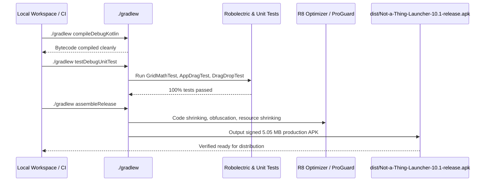

# Not-a-Thing Launcher Architecture & Internals (Version 10.1)

Comprehensive technical documentation of the **Not-a-Thing Launcher** (v10.0 General Availability) architecture, zero-idle battery subsystem, in-memory icon caching engine, unified 2D grid workspace, and bespoke dot-matrix procedural graphics pipeline.

---

## 1. High-Level Architecture Overview

Not-a-Thing Launcher is built on modern Android native architecture (Kotlin, Jetpack ViewModels, ViewBinding, ViewPager2/RecyclerView, custom ViewGroup `CellLayout`) designed specifically for maximum fluidity, zero idle power consumption, and the stark Nothing OS design language (pure AMOLED black `#000000`, bone-white `#F6F6F4`, dot-matrix LED displays, typography-first layouts, and focused red accents `#D71921`).

```mermaid
graph TD
    subgraph UI ["User Interface Layer"]
        MA[MainActivity]
        HF[HomeFragment]
        ADF[AppDrawerFragment]
        SA[SettingsActivity]
        WPA[WorkspacePageAdapter]
        CL[CellLayout 2D Grid]
        SGL[SwipeGestureLayout]
        DC[DragController]
    end

    subgraph State ["State & ViewModel Layer"]
        VM[LauncherViewModel]
        LP[LauncherPrefs - Schema v3]
    end

    subgraph Performance ["Caching & Optimization Engine"]
        IF[IconFactory LruCache 300]
        LCC[Lifecycle & Visibility Gatekeeper]
    end

    subgraph Hardware ["Hardware, Sensors & System Interfaces"]
        WHM[WidgetHostManager & AppWidgetHost]
        AWM[AppWidgetManager]
        LApps[LauncherApps & PackageCallback]
        Sensors[SensorManager - Compass & Steps]
        MS[MediaSessionRepository]
        VR[VoiceRecorder]
    end

    subgraph CustomViews ["Procedural Dot Matrix Views - Visibility Gated"]
        DF[DotFont Engine]
        DGD[DotGridDrawable]
        DMV[DotMatrixClockView]
        STV[SecondsTickerView]
        BDV[BatteryDotsView]
        BGDV[BatteryGaugeDotsView]
        WTD[WeatherDotsView]
        QDV[QuoteDotsView]
        PDV[PedometerDotsView]
        CPV[CompassDotsView]
        STD[ScreenTimeDotsView]
        STR[StorageDotsView]
        SWD[StopwatchDotsView]
        VRD[VoiceRecorderDotsView]
        ACD[AnalogClockDotsView]
        WCD[WorldClockDotsView]
    end

    MA --> HF
    MA --> ADF
    MA --> SGL
    MA --> LCC
    LCC --> Sensors
    HF --> WPA
    WPA --> CL
    CL --> CustomViews
    CL --> WHM
    WHM --> AWM
    HF --> VM
    ADF --> VM
    VM --> LP
    VM --> LApps
    VM --> IF
    CustomViews --> DF
    CustomViews --> DGD
    DC --> CL
    DC --> MA
```

---

## 2. Core Subsystems & Components

### 2.1 `MainActivity.kt` & System Lifecycle Orchestration
- **Root Container & View Layering**: Hosts `homeContainer`, `drawerContainer`, drag layers, and drop zone bars.
- **Lifecycle Sensor Management**:
  - `onStart()` invokes `CompassRepository.resume()` and `StepRepository.resume()`.
  - `onStop()` invokes `CompassRepository.pause()` and `StepRepository.pause()`. When the device screen locks or another foreground activity takes focus, all underlying sensor hardware bus polling is completely disconnected.
- **Dynamic Drawer Scrubbing Throttling**:
  - `applyDrawerProgress(progress)` monitors drawer pull offset. If `drawerProgress > 0.05f`, compass hardware event delivery is halted in real-time to save CPU cycles and power during app search.
- **System Theme & Window Insets**:
  - Implements full edge-to-edge system insets via `WindowCompat.setDecorFitsSystemWindows(window, false)`.
  - Drop zone headers and navigation padding dynamically adapt to display cutouts, camera punch-holes, and gesture bars.
  - Automatically clears `IconFactory` cache when night mode or icon style changes.

### 2.2 `HomeFragment.kt`, `WorkspacePageAdapter.kt` & `CellLayout.kt`
- **Multi-Page Horizontal Workspace**: Implements a horizontal `RecyclerView` locked to page bounds with Android's `PagerSnapHelper`.
- **Page-Aware Sensor Throttling**:
  - `setCurrentPage(index)` inspects whether the target page hosts a compass element (`BespokeElement.COMPASS.id`). If the user navigates away to a page without a compass, the compass hardware listener is paused immediately.
- **Unified Native 2D Grid (`CellLayout`)**:
  - Custom Android `ViewGroup` arranging items on a discrete `(cellX, cellY, spanX, spanY)` 2D coordinate matrix.
  - Sits inside a `NestedScrollView` combining fixed grid alignment with smooth vertical scrolling when widgets expand page bounds.
  - Handles item types: standard 1×1 app icons, 1×1 circular folder discs, 2×2 enlarged interactive folder tiles, 2×2 Max Icons, bespoke Nothing dot elements, and hosted third-party AppWidgets.
- **Fluid Drag-and-Drop Controller (`DragController.kt`)**:
  - Spring-loaded page navigation while dragging items near page edges.
  - Dynamic folder merge ring when dragging an app icon over another.
  - Coordinate resolution via `pointToCell` with real-time drop outline drawing.
  - Top action zones for *Remove from Home*, *Uninstall*, and *App Info*.

### 2.3 `IconFactory.kt` & In-Memory LRU Caching
- **The Problem**: In stock Launcher architectures, synchronous bitmap decoding, adaptive icon layer compounding, and monochrome matrix filtering stall the main thread during cold start and rapid drawer scrubbing.
- **The v10.0 Solution**:
  - In-memory `LruCache<String, Bitmap>(300)` holding up to 300 pre-rendered bitmaps.
  - Deterministic composite key: `ComponentName#UserSerial#IconStyle#ThemeMode`.
  - First render creates the styled bitmap; subsequent requests resolve in $O(1)$ memory lookup without touching the canvas or allocating memory.
  - Automated invalidation: Cleared on package install/uninstall/update via `LauncherApps.Callback`, icon style setting changes, and dark/light theme transitions.

### 2.4 Zero-Idle Battery Architecture (`DeviceSensors.kt` & Visibility Gating)
- **Sensor Bus Disconnection**:
  - `StepRepository` and `CompassRepository` implement explicit `pause()` and `resume()`.
  - When paused, sensor listeners (`TYPE_ROTATION_VECTOR`, `TYPE_ACCELEROMETER`, `TYPE_MAGNETIC_FIELD`, `TYPE_STEP_COUNTER`) unregister from Android's `SensorManager`, stopping kernel hardware interrupts.
- **View-Level Visibility Aggregation**:
  - All 9 animated custom dot views (`SecondsTickerView`, `DotMatrixClockView`, `BatteryDotsView`, `MediaDotsView`, `StopwatchDotsView`, `VoiceRecorderDotsView`, `SystemMonitorDotsView`, `AnalogClockDotsView`, `WorldClockDotsView`) implement `onVisibilityAggregated(isVisible)` and `isShown` guards.
  - When off-screen, minimized, or obscured, view ticker runnables and `ValueAnimator` pulse loops are cancelled immediately.

### 2.5 Data Persistence & Safe Upgrade Schema (`LauncherPrefs.kt`)
- **Schema Version 3**:
  - Upgraded schema to `SCHEMA_VERSION = 3`.
  - Non-destructive migration validates existing JSON payloads and user preferences.
  - Preserves 100% of user layouts, custom pages, dock configurations, folders, and preferences without data wipes or resets.

---

## 3. The Dot-Matrix Typography & Rendering Engine

### 3.1 `DotFont.kt`
Procedural 5×7 dot-matrix rasterizer for alphanumeric characters, numerals, punctuation, and system glyphs.
- Characters are represented as boolean matrices (lit vs. unlit dots).
- Renders custom text strings into precise 2D dot arrays with controllable dot pitch, dot radius, and spacing.

### 3.2 `DotGridDrawable.kt`
High-performance procedural background drawable rendering the signature Nothing OS dot grid pattern across AMOLED black (`#000000`) or minimalist bone-white (`#F6F6F4`) canvases.

### 3.3 Surface Contrast Architecture
- Pure AMOLED Black: `#000000` deep black canvas for zero-power pixel emission on OLED displays.
- Minimalist Bone-White: `#F6F6F4` clean light mode surface with deep ink text.
- Dark Mode Tokens (`res/values-night/colors.xml`): Added `border_subtle` (`#232327`) and `surface_dark` (`#0C0C0E`), preventing glaring white separator lines on dark drop zone bars and dialogs.

---

## 4. Verification & Build Pipeline

