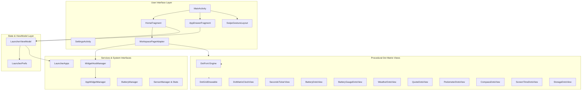
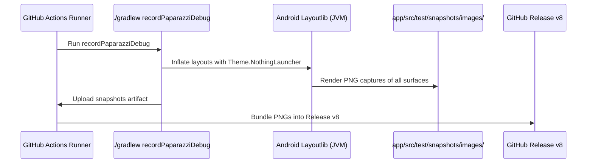

# Not-a-Thing Launcher Architecture & Internals

Comprehensive technical documentation of the **Not-a-Thing Launcher** (v8.0) architecture, visual pipeline, multi-page workspace, and custom element engine.

---

## 1. High-Level Architecture Overview

Not-a-Thing Launcher is built on modern Android native architecture (Kotlin, Jetpack ViewModels, ViewBinding, ViewPager2/RecyclerView) designed specifically for maximum fluidity, minimal power consumption, and the stark Nothing OS design language (monochrome, dot-matrix LED displays, typography-first layouts, and focused red accents).

---

## 2. Core Components

### 2.1 `MainActivity.kt`
- **Root Container**: Hosts the layered `homeContainer` and `drawerContainer` FrameLayouts.
- **Gesture Tracker**: Intercepts vertical drag touches (`SwipeGestureLayout`), driving the app drawer elevation with fluid physics and real-time backdrop blur on supported Android 12+ devices (`RenderEffect.createBlurEffect`).
- **Dialog & Sheet Orchestrator**: Displays the long-press Home Customisation sheet, Wallpaper & Style sheet, Note editor, and AppWidget configuration flows.
- **System Callbacks**: Handles navigation bar/status bar contrast (`WindowCompat`), home button intents (`ACTION_MAIN`), and the Android back gesture callback (`OnBackPressedCallback`).

### 2.2 `HomeFragment.kt` & `WorkspacePageAdapter.kt`
- **Multi-Page Horizontal Workspace**: Implements a horizontal `RecyclerView` locked to page bounds with Android's `PagerSnapHelper`.
- **Dynamic Paging**: Users can swipe horizontally across unlimited home workspace pages. The minimalist dot indicator (`PageIndicatorView`) animates dot width and position synchronously with scroll offsets.
- **Page Composition**:
  - Top Clock & Bespoke Elements Row (LED-panel clock, battery circle, calendar tile).
  - Configurable Bespoke Elements: Battery Gauge, Quick Note, Weather, Quick Toggles, Step Counter, Compass, Screen Time, Storage & RAM, and World Clock.
  - Third-party Android AppWidgets hosted via `AppWidgetHost`.
  - App Grid with support for standard 1×1 icons and 2×2 Max Icons.

### 2.3 `AppDrawerFragment.kt`
- **Alphabetical Indexing & Fast Scroller**: Custom `AlphabetScrollerView` allows instantaneous scrubbing across alphabet sections with haptic tick feedback.
- **Intelligent Ranked Search**:
  - Direct Prefix Matches (highest priority).
  - Word Start Matches (e.g. "note" matches "Keep Notes").
  - Substring Matches.
  - Initials Acronyms (e.g. "gm" matches "Google Maps", "ps" matches "Play Store").
- **Recent Apps**: Dynamically prioritizes the top 4 most recently launched packages.
- **Hidden Apps**: Packages can be hidden from drawer and restored through Settings.

### 2.4 `LauncherViewModel.kt` & `LauncherPrefs.kt`
- **Clean Persistence**: SharedPreferences-backed configuration with typed accessors. Changes increment `settingsVersion` to broadcast updates across views without unnecessary layout churn.
- **Workspace Layout JSON**: Multi-page layouts (page count, element positions, widget IDs, folder contents, and icon placements) are serialized deterministically in JSON.

---

## 3. The Dot-Matrix Typography & Rendering Engine

### 3.1 `DotFont.kt`
Procedural 5×7 dot-matrix rasterizer for alphanumeric characters, numerals, punctuation, and system glyphs.
- Characters are represented as boolean matrices (lit vs. unlit dots).
- Renders custom text strings into precise 2D dot arrays with controllable dot pitch, dot radius, and spacing.

### 3.2 `DotGridDrawable.kt`
High-performance procedural background drawable rendering the signature Nothing OS dot grid pattern across AMOLED black or minimalist white canvases.

### 3.3 Bespoke Element Views
Every bespoke element extends Android's `View` and uses hardware-accelerated 2D canvas drawing:
- **`BatteryGaugeDotsView`**: Live battery gauge with circular dot meter (28-dot arc), live charging status, and DotFont percentage.
- **`BatteryDotsView`**: Compact 40-dot ring with breathing dot animation during active charging and automatic sticky battery intent polling.
- **`QuoteDotsView`**: Home screen daily quote/scratchpad rendered in dot-matrix font with single-tap quick note modal editing.
- **`DotMatrixClockView`**: Full grid LED clock panel with pulsating colon and seconds ticker.
- **`WeatherDotsView`**: Procedural dot-matrix sun/cloud/rain icons, live temperature, and conditions.
- **`StorageDotsView`**: Dynamic storage block calculation using `StatFs` to render free/total disk usage and circular capacity meter.

---

## 4. Screenshot Testing Suite (Paparazzi)

Not-a-Thing Launcher uses **Cash App Paparazzi** for pixel-perfect screenshot verification without requiring an Android emulator or physical device.

- Tests in `ScreensTest.kt` exercise:
  - Home workspace (1-page, multi-page, empty state, 4-column, 5-column, color icons).
  - Drawer (normal view, search query, empty search with web search fallback).
  - Long-press sheets (Home customisation sheet, wallpaper & style dialog, app popup).
  - Settings screens (top section, bottom section with About info).
  - Bespoke widgets (Battery gauge, Quick note, Weather, Screen time, Storage, World clock).
