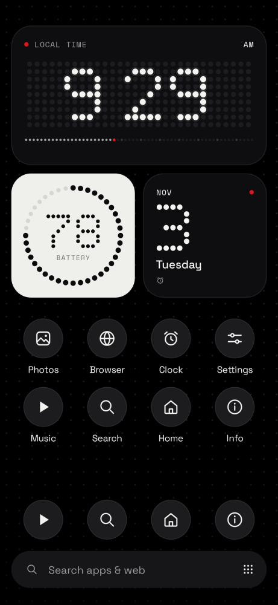
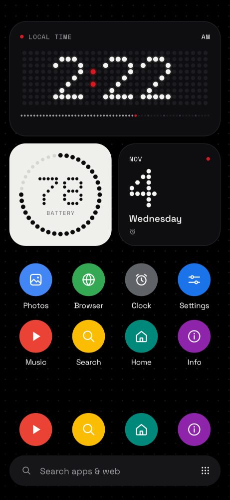
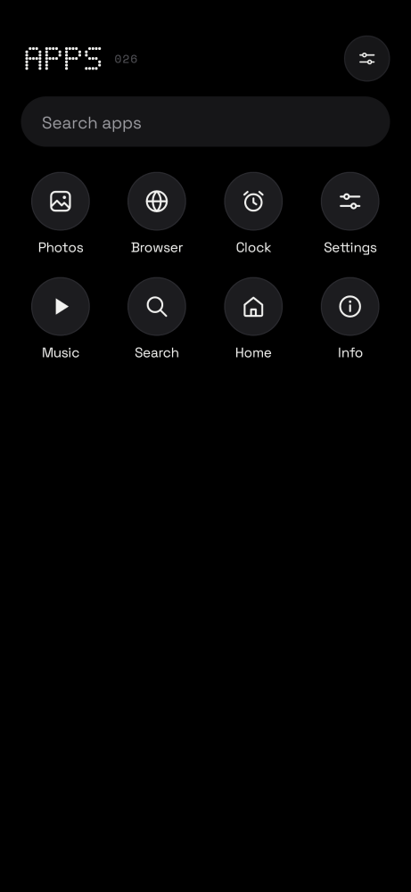
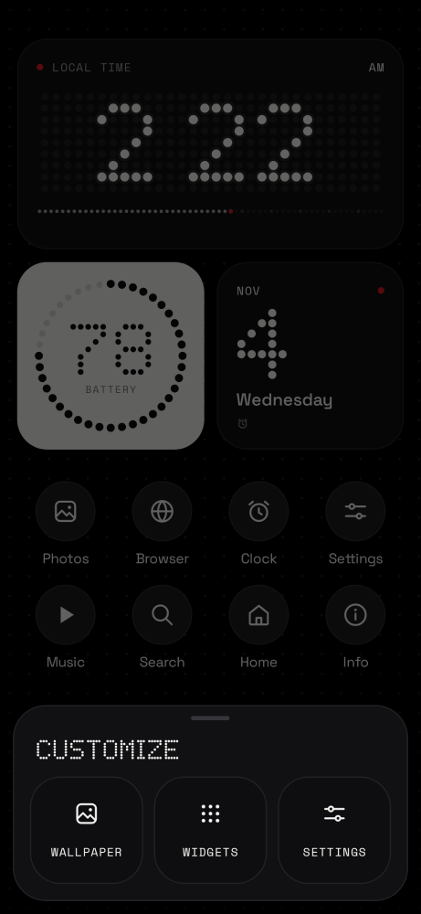
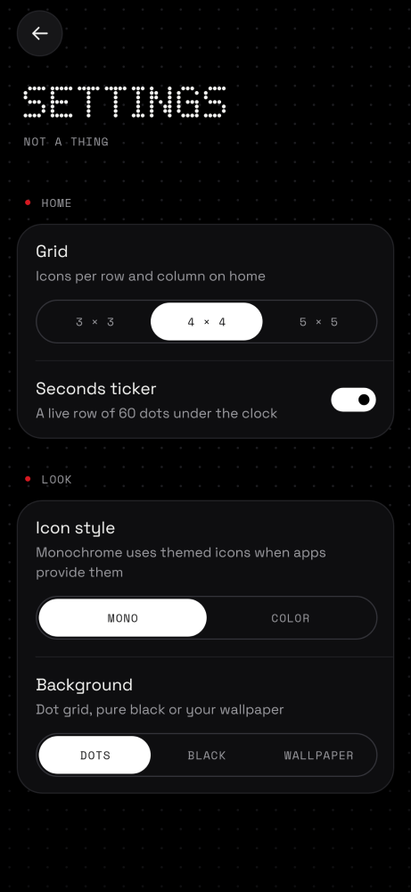
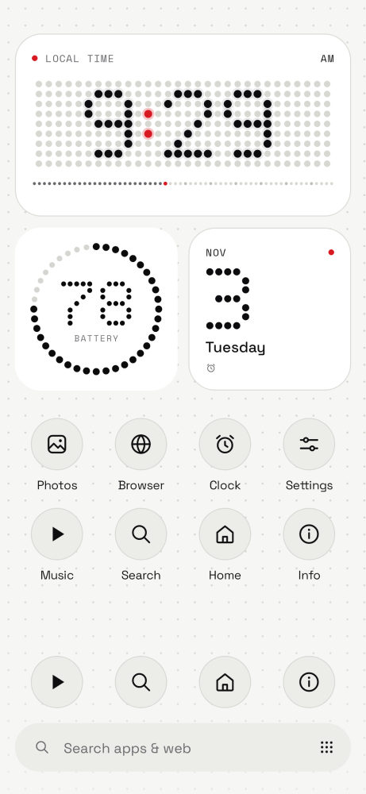
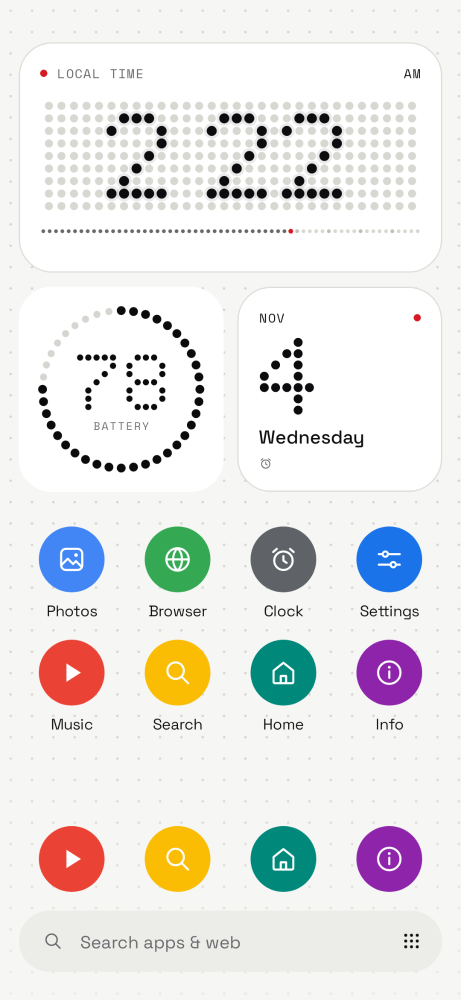
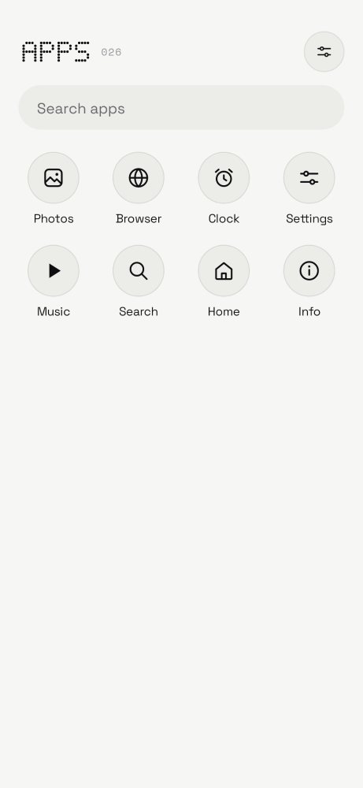
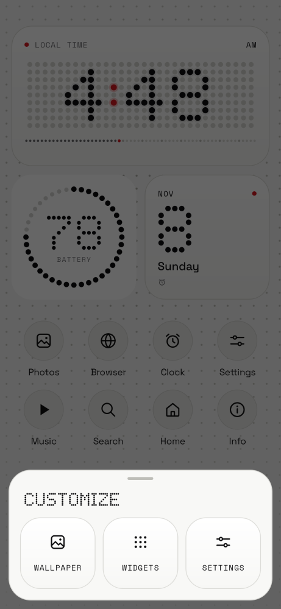
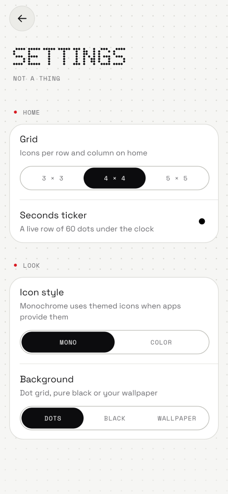

# Screenshots

All screenshots below are generated deterministically by the Paparazzi (layoutlib) tests in
[`app/src/test/java/com/nothinglauncher/ScreensTest.kt`](../app/src/test/java/com/nothinglauncher/ScreensTest.kt) —
no emulator or device involved. Regenerate them with:

```bash
./gradlew recordPaparazziDebug
```

Output lands in `app/src/test/snapshots/images/`, named `com.nothinglauncher_<TestClass>_<name>.png`.
CI (`.github/workflows/build.yml`) records them on every build and uploads them as an artifact,
and `testDebugUnitTest` fails the build if a layout changes without re-recording.

## Dark mode (`ScreensDarkTest`)

| | |
|---|---|
|  Home — monochrome icons |  Home — colour icons |
|  App drawer |  Customize sheet |
|  Settings | |

## Light mode (`ScreensLightTest`)

| | |
|---|---|
|  Home — monochrome icons |  Home — colour icons |
|  App drawer |  Customize sheet |
|  Settings | |

For the pre-v11.0 bespoke launcher's screenshot catalog, see
[`archive/SCREENSHOTS.v10.1.md`](archive/SCREENSHOTS.v10.1.md) (historical only — that UI no
longer exists).
