# Not-a-Thing Launcher: Visual Showcase & Screenshots

All screenshots below are generated deterministically using **Cash App Paparazzi** (`app.cash.paparazzi`) and Android Layoutlib directly from the launcher's layout definitions and custom views.

---

## 1. Workspace & Home Screens

### 1.1 Default Home Workspace
The signature Nothing OS home screen: monochrome palette, dot-matrix LED clock with accent colon, compact 40-dot battery circle, calendar tile, pinned apps, dot page indicator, and dock.

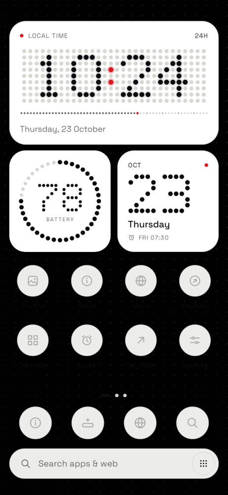

---

### 1.2 Five Columns & Color Icons (Minimalist Mode)
Home screen configured for maximum density (5 columns), app labels hidden, and original color icon badges.

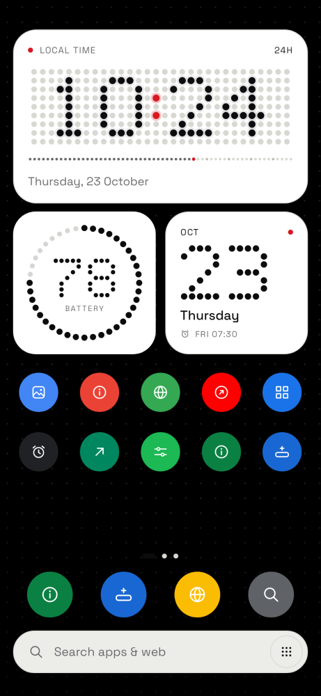

---

### 1.3 Clean Empty Home State
Minimalist zen view when no apps are pinned ("Your space, nothing else") with LED clock panel.

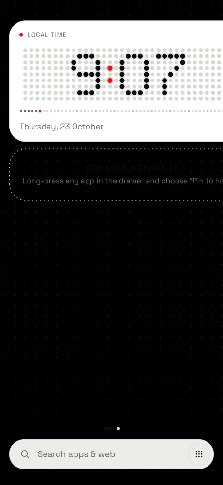

---

### 1.4 Multi-Page Workspace: Page 2 (Weather & Quick Toggles)
Second workspace page featuring the procedural Weather tile, Quick Toggles tile, and active dot on the page indicator.

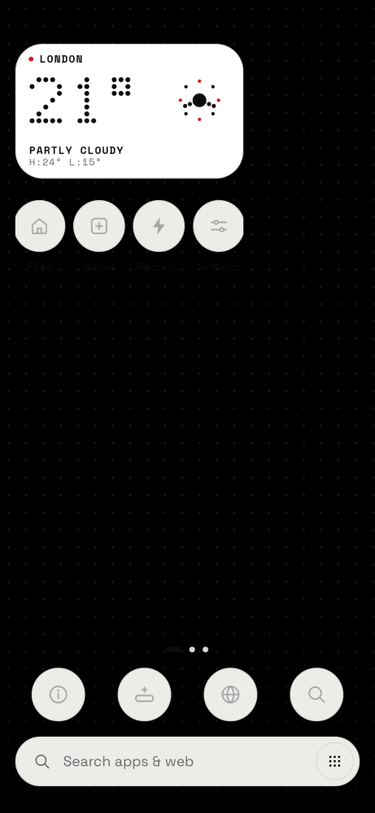

---

### 1.5 Multi-Page Workspace: Page 3 (Wellbeing, Storage & World Clock)
Third workspace page hosting the Screen Time / Digital Wellbeing tile, Internal Storage & RAM meter, and World Clock tile.

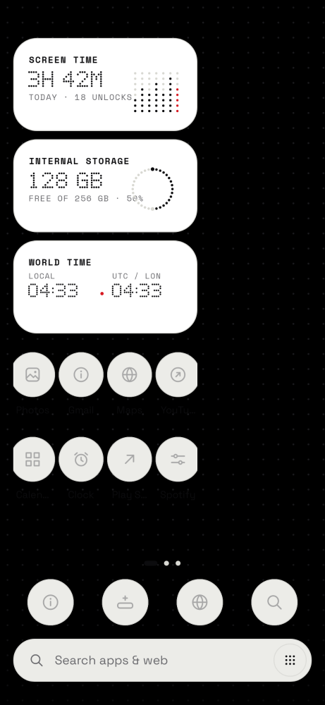

---

## 2. App Drawer & Search

### 2.1 Full App Drawer & A–Z Dot Scroller
Fluid app drawer with Recent Apps shelf, categorized app grid, and right-hand A–Z alphabet scrubber.

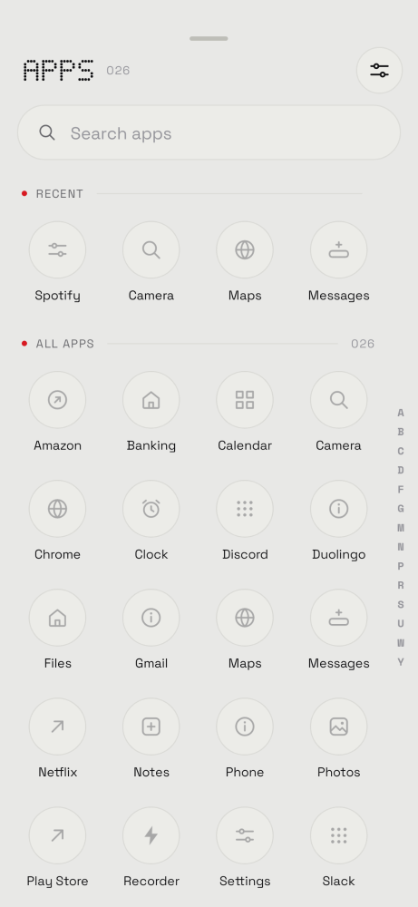

---

### 2.2 Ranked Search & Web Search Fallback
Real-time search with query clearing and immediate one-tap Google web search button when no local app matches.

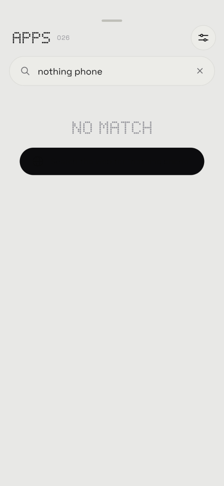

---

## 3. Long-Press Menus & Customisation Sheets

### 3.1 App Long-Press Popup (`AppPopup`)
Long-pressing an app icon surfaces dynamic app shortcuts (e.g. Spotify Search & Liked songs), Remove from home, Add to dock, App info, Hide, and Uninstall.

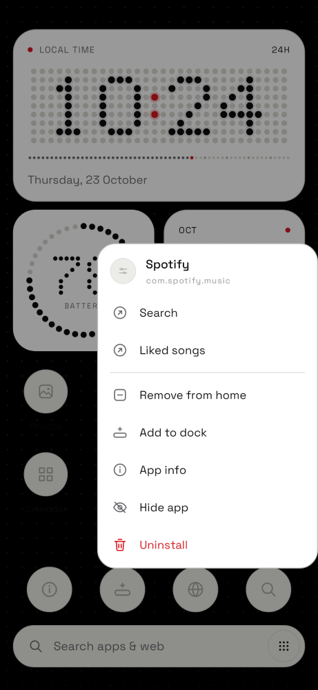

---

### 3.2 Home Screen Long-Press Sheet (`Home Customisation`)
Long-pressing empty space on any workspace page triggers haptic feedback and displays the bottom customisation sheet overlaid on the home screen.

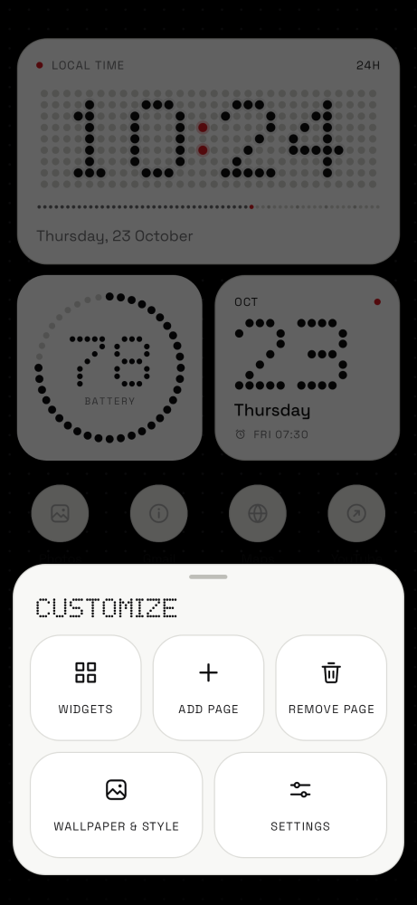

---

### 3.3 Standalone Customisation Sheet Tiles
Close-up render of the 5 customisation sheet action tiles: Widgets, Add Page, Remove Page, Wallpaper & Style, and Settings.

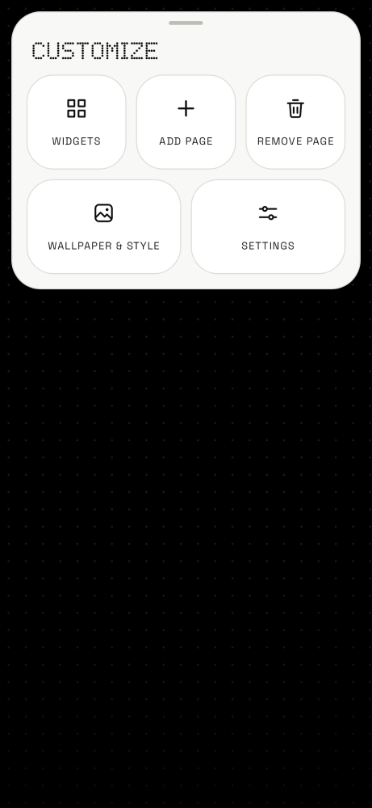

---

### 3.4 Wallpaper & Style Center
Dedicated modal sheet for switching background styles (Nothing Dot Matrix, Solid Minimalist, System Wallpaper) and theme mode (System, Dark, Light).

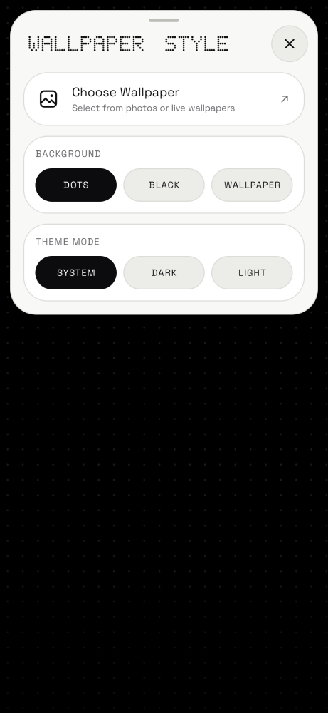

---

## 4. Bespoke Nothing Elements (v8.0)

### 4.1 Battery Gauge Hero Tile
Full-width hero tile displaying DotFont battery percentage, charging state, and 28-dot circular capacity meter with charging bolt.

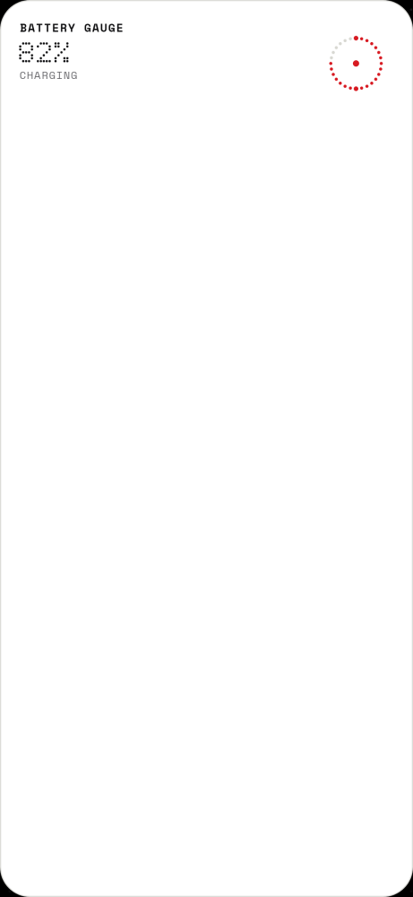

---

### 4.2 Quick Note / Daily Quote Scratchpad
Dot-matrix scratchpad element for user quotes, notes, or daily goals with live accent dot indicator.

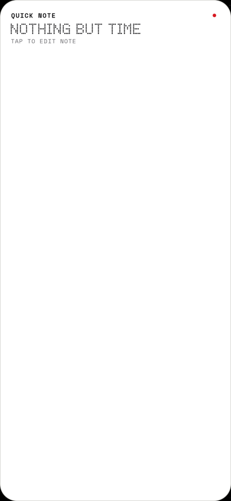

---

## 5. Settings & Confirmations

### 5.1 Settings: Home & Look
Settings screen displaying grid column picker (4 or 5), app label toggles, seconds ticker, and background selection.

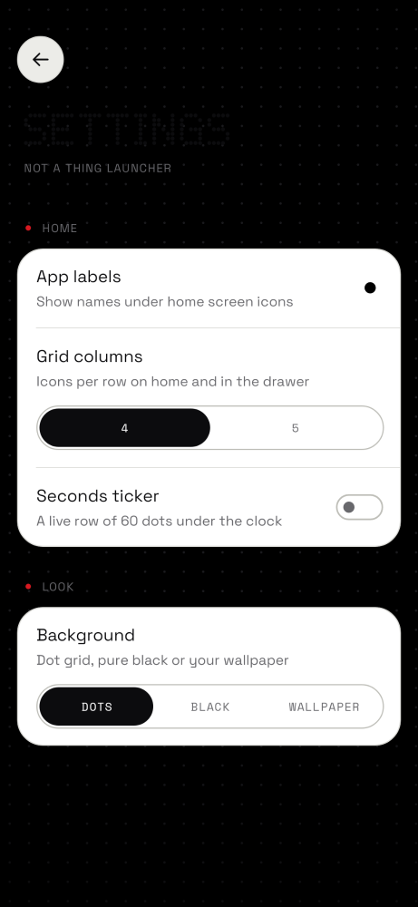

---

### 5.2 Settings: Drawer, System & About v8.0
Settings screen displaying Drawer recents, hidden apps manager, default home app status, reset layout, and Version 8.0 About info.

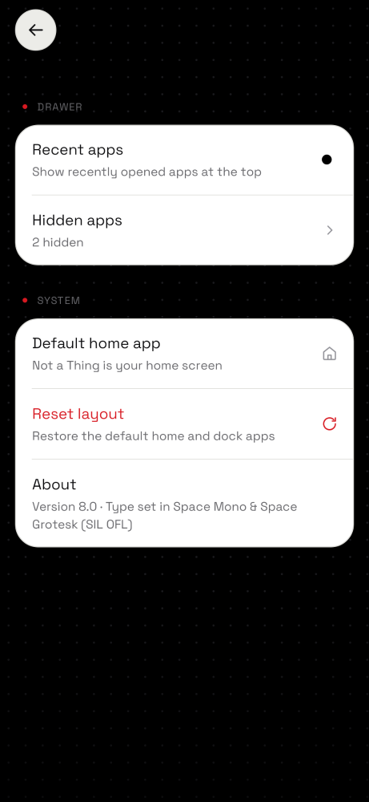

---

### 5.3 Reset Layout Confirmation Dialog
System confirmation dialog in the launcher's typography and bottom-sheet container.

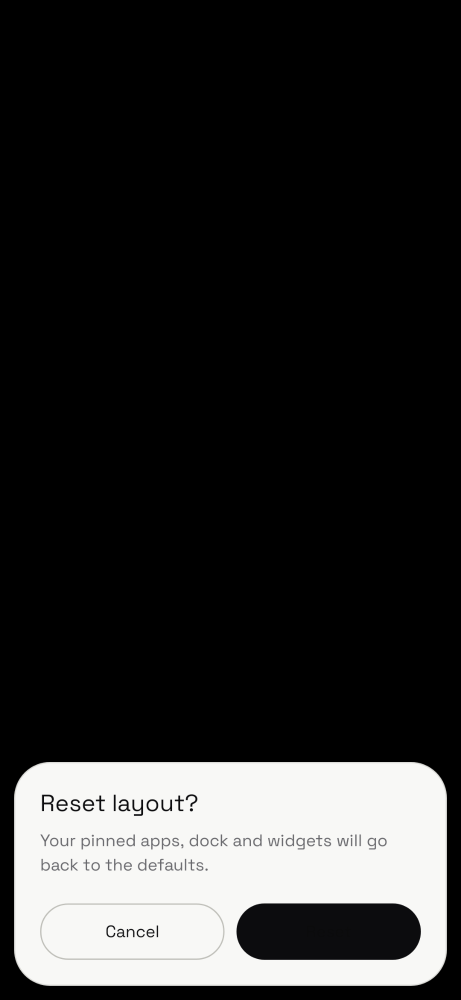

---

### 5.4 Icon Engine Styles (Mono vs Color)
Comparison of Nothing OS monochrome discs against full-color circular app icons.

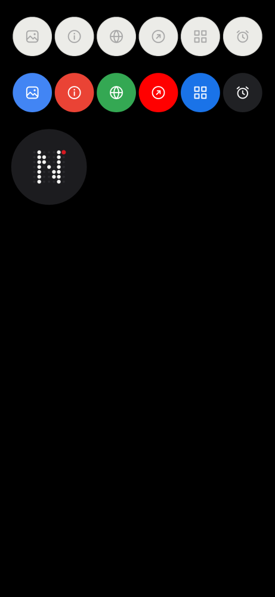
